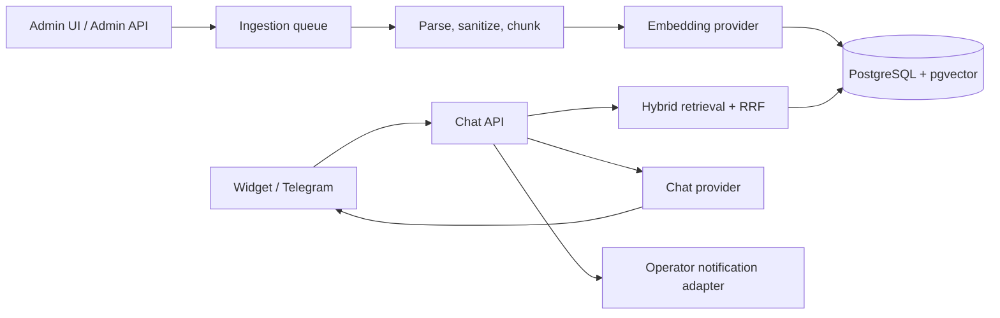

# DocMind implementation roadmap

This document is the delivery plan for the portfolio version of DocMind. Each phase ends in a runnable, demonstrable increment; later phases extend the same interfaces rather than replacing the core.

## Product boundary

DocMind answers only from customer-owned knowledge-base documents. It supports a web widget and Telegram as input channels, records the retrieval evidence used for every answer, and hands conversations to a human when evidence is insufficient or requested. The initial demo is a fictional Berlin legal firm, but no domain wording is embedded in core business rules.

## Architecture baseline

Provider and notification integrations are ports: `internal/ai` and `internal/notify` own interfaces; OpenRouter, deterministic demo AI, Slack, and Telegram are adapters. PostgreSQL is the production persistence implementation; domain services do not construct SQL directly.

## Data model

| Entity | Responsibility | Important invariants |
|---|---|---|
| `documents` | identity, source hash, active version | a content hash is unique; duplicate uploads do not create a new document |
| `document_versions` | staging and published versions | only a fully indexed version can become active |
| `chunks` | text, section, position, `tsvector`, pgvector embedding | each chunk belongs to one immutable version |
| `ingestion_jobs` | durable visibility of asynchronous work | status transitions are queued → processing → completed/failed |
| `conversations` / `messages` | audit-safe chat history | incoming question is persisted before any provider call |
| `message_sources` | exact retrieval context | source snapshot remains available for admin debugging |
| `feedback`, `escalations`, `dead_letters` | quality feedback and operational follow-up | failed provider calls remain diagnosable |

## Delivery phases

### Phase 1 — RAG core (current)

**Goal:** a complete local demonstration of document ingestion, hybrid retrieval, and source-grounded answers.

- Go 1.22 HTTP API built on `net/http`; JSON `slog` logging and config from environment.
- Versioned PostgreSQL migrations with pgvector extension.
- Markdown, TXT, and HTML upload parsing; HTML removes scripts/styles and is reduced to plain text.
- Sentence-aware, configurable chunking with overlap.
- Bounded asynchronous ingestion queue returning `202 Accepted` and a job ID.
- Deterministic 64-dimensional embedding and chat adapters for zero-key demo mode.
- PostgreSQL vector similarity and full-text searches fused using Reciprocal Rank Fusion (RRF).
- Relevance threshold and explicit “not found” response; answers include persisted, clickable source metadata.
- Save-first question persistence, health/readiness endpoints, graceful shutdown.
- Unit tests for chunking, RRF, query rewriting, and fake-AI end-to-end behavior.
- Docker Compose with PostgreSQL/pgvector and a non-root API container; seed command and sample legal-firm documents.

**Manual acceptance:** upload `services.md`, poll the job until completed, then send “How much does an initial consultation cost?” and receive an answer with the Pricing source.

### Phase 2 — resilience and secure ingestion

- PDF extraction and URL ingestion with SSRF allow-listing, timeouts, content-type checks and size caps.
- Database-backed recovery of queued jobs on restart; exponential retry and dead-letter policy.
- Atomic reindex and delete flows, content-hash deduplication UI, document status and chunk counts.
- OpenRouter adapters for chat and embeddings, request timeouts, temporary-error retry and token accounting.
- Admin Bearer authentication, CORS policy, IP/session rate limiting and request-size limits.
- Prompt-injection-resistant context envelope; regression tests ensure document instructions cannot alter system constraints.
- Prometheus metrics for retrieval/generation latency, queue depth, provider failures, not-found ratio and tokens.

### Phase 3 — user channels and handoff

- Single-script vanilla JS/CSS widget with SSE token streaming, source disclosure, feedback and “talk to a person”.
- Conversation-aware query rewriting and a bounded history policy.
- Telegram Bot API adapter with the same conversation service.
- Notification port with structured log implementation plus Slack/Telegram adapters.
- Escalation rule: explicit human request, button click, or insufficient evidence.

### Phase 4 — admin experience and portfolio finish

- React/Vite admin console: documents, ingestion status, reindex/delete, searchable conversations, source context, feedback and dashboard.
- Dashboard: daily questions, not-found and escalation ratios, average latency, answer ratings and top questions.
- nginx edge configuration, production compose profile and image hardening.
- GitHub Actions: format/test, `go vet`, race detector, image build and Compose smoke test.
- README in English with screenshots/GIFs, architecture, 3-command quick start, design decisions, operational metrics and known limits.

## Quality gates

| Phase | Automated gate |
|---|---|
| 1 | `go test ./...`, `go vet ./...`, Compose API health check |
| 2 | migration upgrade, reindex atomicity, transient-provider retry, security regression tests |
| 3 | browser/widget SSE test and Telegram adapter contract tests |
| 4 | CI green on a clean checkout; visual QA of admin and widget |

## Deliberate decisions

- **Hybrid search:** semantic retrieval helps paraphrases; full-text retrieval preserves exact legal/product terms. RRF combines their rank order without fragile score calibration.
- **Save-first:** the customer question is persisted before an external AI call, preserving the audit trail through provider outages.
- **Versioned chunks:** a version is published in one database transaction, preventing partial reindex results from being served.
- **Demo adapters:** deterministic local embeddings and answers make the portfolio project runnable without credentials. Real adapters use the same ports.
- **Evidence before generation:** a threshold is applied before generation. Absence of adequate evidence produces a useful refusal and operator path rather than a plausible answer.
